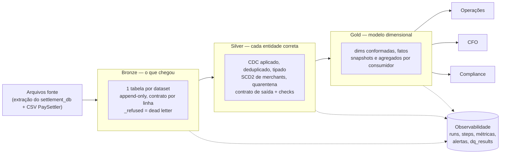

# Case Técnico — Engenheiro(a) de Dados Sênior / Especialista

## Contexto de Negócio

Você está entrando no time de dados de uma fintech que processa liquidações de pagamentos para merchants. A empresa opera o **Settlement Reconciliation Service** — um serviço em produção que:

1. Recebe diariamente um **arquivo CSV** do processador de pagamentos externo (**PaySettler**) com as transações liquidadas nas últimas 24h
2. Compara essas transações com os **registros internos** do sistema
3. Categoriza cada transação e persiste os resultados em um **PostgreSQL** (`settlement_db`)

O serviço funciona bem, mas **todos os dados vivem apenas no banco transacional**. O time de operações precisa saber se a taxa de discrepância está subindo. O CFO quer o volume transacionado por dia. Compliance precisa de histórico de auditoria. **Ninguém tem acesso estruturado a nada disso hoje.**

### Sua Missão

Construir uma solução que transforme esses dados em **produtos de dados** consumíveis pelo negócio. Cabe a você decidir como.

---

## Domínio: Reconciliação de Liquidações

> O glossário completo está em [`docs/domain-glossary.md`](docs/domain-glossary.md). Leia antes de começar.

### Tabelas Fonte (`settlement_db`)

**`transactions`** — Transações internas do sistema

| Coluna | Tipo | Descrição |
|--------|------|-----------|
| `id` | bigint | PK |
| `transaction_id` | uuid | Identificador único da transação |
| `merchant_id` | varchar | Identificador do merchant |
| `amount` | decimal | Valor da transação (BRL) |
| `currency` | varchar | Moeda (ISO 4217) |
| `status` | varchar | `COMPLETED`, `PENDING`, `FAILED` |
| `description` | varchar | Descrição da transação |
| `created_at` | timestamp | Data de criação |
| `updated_at` | timestamp | Última atualização |

**`reconciliation_runs`** — Execuções de reconciliação

| Coluna | Tipo | Descrição |
|--------|------|-----------|
| `id` | bigint | PK |
| `reference_date` | date | Data de referência do arquivo (dia de negócio) |
| `file_name` | varchar | Nome do arquivo processado |
| `status` | varchar | `IN_PROGRESS`, `COMPLETED`, `FAILED` |
| `total_transactions` | integer | Total de transações no arquivo |
| `started_at` | timestamp | Início do processamento |
| `completed_at` | timestamp | Fim do processamento |
| `created_at` | timestamp | Data de criação do registro |

**`reconciliation_results`** — Resultados da reconciliação

| Coluna | Tipo | Descrição |
|--------|------|-----------|
| `id` | bigint | PK |
| `run_id` | bigint | FK → `reconciliation_runs.id` |
| `transaction_id` | uuid | Identificador da transação |
| `merchant_id` | varchar | Identificador do merchant |
| `category` | varchar | `MATCHED`, `MISMATCHED`, `UNRECONCILED_PROCESSOR`, `UNRECONCILED_INTERNAL` |
| `internal_amount` | decimal | Valor no sistema interno (null se unreconciled_processor) |
| `processor_amount` | decimal | Valor no PaySettler (null se unreconciled_internal) |
| `difference` | decimal | Diferença absoluta entre valores |
| `created_at` | timestamp | Data de criação |

**`enterprise_company`** — Dados cadastrais dos merchants

| Coluna | Tipo | Descrição |
|--------|------|-----------|
| `id` | bigint | PK |
| `merchant_id` | varchar | Código do merchant |
| `legal_name` | varchar | Razão social |
| `trade_name` | varchar | Nome fantasia |
| `document` | varchar | CNPJ |
| `primary_cnae` | varchar | CNAE principal |
| `created_at` | timestamp | Data de criação |
| `updated_at` | timestamp | Última atualização |

### Arquivo CSV do PaySettler

O processador externo envia diariamente um CSV com as transações liquidadas.

| Coluna | Tipo | Descrição |
|--------|------|-----------|
| `transaction_id` | uuid | Identificador da transação |
| `merchant_id` | varchar | Identificador do merchant |
| `amount` | decimal | Valor liquidado |
| `currency` | varchar | Moeda (ISO 4217) |
| `settled_at` | datetime (ISO 8601, UTC) | Data/hora da liquidação |
| `processor_reference` | varchar | Referência interna do processador |
| `status` | varchar | `SETTLED` ou `REVERSED` |

---

## Stack

- **Linguagem:** Python 3.12+
- **Processamento:** DuckDB
- **Conteinerização:** Docker + Docker Compose
- **Armazenamento:** Filesystem local

A solução deve **rodar localmente** com `docker-compose up`.

---

## Dados de Exemplo

Na pasta `docs/sample-data/` você encontrará:

- `transactions_batch_1.parquet` — Transações internas (lote 1)
- `transactions_batch_2.parquet` — Transações internas (lote 2)
- `reconciliation_runs.parquet` — Execuções de reconciliação
- `reconciliation_results.parquet` — Resultados categorizados
- `settlement_paysettler.csv` — Arquivo CSV do PaySettler
- `enterprise_company.parquet` — Dados cadastrais de merchants

---

## Como Começar

1. **Faça um fork** deste repositório para sua conta pessoal do GitHub
2. Clone o seu fork e trabalhe nele normalmente
3. Suba o ambiente:

```bash
docker compose up -d --build
# ou: make up
```

Um `Makefile` no repositório expõe atalhos para as operações mais comuns (`make help` lista os alvos disponíveis). O uso é opcional.

---

## Requisitos

### Parte 1 — Modelagem e Analytics

Usando os dados disponíveis, **modele e implemente tabelas analíticas** que atendam os seguintes consumidores:

- **Operações:** precisa acompanhar a saúde das reconciliações no dia a dia
- **CFO:** precisa de visão consolidada do volume financeiro
- **Compliance:** precisa de rastreabilidade e histórico para auditorias

**A forma e o conteúdo das tabelas são decisão sua.** Traduza as dores acima em métricas e tabelas analíticas (fatos e dimensões) que você defenderia em produção. Documente, para cada consumidor:

- **Quais perguntas** seu modelo consegue responder (e quais deliberadamente não)
- **Por que** essas e não outras (priorização, tradeoffs de escopo vs tempo)

Entregue também exemplos de queries rodando contra suas tabelas que respondem as perguntas que você propôs. Queremos ver seu raciocínio de produto, não só SQL.

---

### Parte 2 — Pipeline de Dados

Implemente o pipeline que processa as fontes de dados disponíveis e prepara o insumo para as tabelas analíticas da Parte 1.

O volume em `docs/sample-data/` é pequeno de propósito — assuma **~5M transações/mês em produção** e projete para crescer. Se quiser validar na prática como seu pipeline se comporta em escala, use o gerador descrito na seção _"Dados de Exemplo e Geração de Volume"_.

Critérios de qualidade (como você os atende é decisão sua — documente suas escolhas):

- **Correção:** a saída do pipeline bate com o contrato de dados que você propôs
- **Idempotência:** executar o pipeline para a mesma data de referência duas vezes não pode duplicar registros nem corromper as tabelas. Considere como isso se manifesta na sua CLI, nas tabelas finais e em falhas no meio da execução
- **Observabilidade:** em produção, quando algo quebrar, que sinais você precisaria para diagnosticar rapidamente?
- **Qualidade de dados:** quais checks você adicionaria para proteger os consumidores de downstream de dados incorretos? O que faria o pipeline parar versus apenas alertar?
- **Testabilidade:** como você valida automaticamente que uma mudança no código não quebra o comportamento?

Stack obrigatória: **DuckDB** para processamento, **Python 3.12+**, **Docker Compose** para subir o ambiente.

---

### Parte 3 — Arquitetura

#### 3.1 Desenho de Arquitetura

**Explique e/ou desenhe** como você levaria esses dados do banco transacional até o consumo pelo negócio em produção.

#### 3.2 Troubleshooting

Segunda-feira de manhã. Ops abre um chamado: os dashboards de reconciliação estão sem dados desde sexta-feira à noite. Você é o primeiro a chegar.

Como você investigaria? Que artefatos do próprio pipeline você consultaria? Até onde iria antes de acionar mais alguém?

#### 3.3 Escalabilidade

Hoje o volume é pequeno, mas o negócio projeta chegar em **~5M transações/dia** em 18 meses (≈1,8B/ano em `reconciliation_results`). Como você prepararia a plataforma para esse crescimento? Onde o desenho atual quebra primeiro?

---

## Dados de Exemplo e Geração de Volume

O repositório oferece duas fontes de dado. **A escolha de volume e de quais fontes usar é sua.**

### 1. Fixture pequeno — `docs/sample-data/`

Cerca de 1.000 transações internas e ~500 liquidações. Pensado para exploração, desenvolvimento local e como insumo default dos exemplos de queries da Parte 1.

### 2. Gerador sintético — `scripts/generate_sample_data.py`

Produz o mesmo schema do fixture (CDC `Op`/`_timestamp`, schema drift entre batches, padrões realistas de dados sujos) em volume arbitrário. Útil para validar seu pipeline em escala — por exemplo, ao redor dos ~5M transações/mês assumidos na Parte 2.

**Você define o volume e as características.** O script é parametrizável:

```bash
# dataset médio para smoke em escala (1M transações, 90 dias)
python scripts/generate_sample_data.py --rows 1000000 --days 90 --out /tmp/medium

# dataset alinhado à projeção de ~5M transações/mês
python scripts/generate_sample_data.py --rows 5000000 --days 30 --out /tmp/month
```

Flags principais:

| Flag | Descrição | Default |
|------|-----------|---------|
| `--rows N` | Total de transações internas a gerar | `1000000` |
| `--days N` | Janela temporal em dias | `90` |
| `--merchants N` | Número de merchants | `500` |
| `--seed N` | Semente determinística | `42` |
| `--out PATH` | Diretório de saída | `docs/sample-data` |

Rode `python scripts/generate_sample_data.py --help` para a lista completa. Dentro do container, `make generate` (10k linhas) e `make generate-large` (1M linhas) são atalhos prontos.

---

## Uso de IA

Fique à vontade para usar ferramentas de IA durante o desafio. Se usar, documente no item _"Ferramentas de IA utilizadas"_ da entrega quais ferramentas e para quê. Se mantiver prompts, configs (`CLAUDE.md`, `.cursorrules`, etc.) ou transcrições no repositório, melhor — ajuda a entender seu processo.

---

## Entrega

1. Ao finalizar, **abra um Pull Request do seu fork para o repositório original** (branch `main`)
2. Preencha as seções abaixo no README do seu PR:

### Como rodar

Pré-requisitos: Docker com Docker Compose e `make`; no Windows, o Git Bash fornece o `make`. O `make` é opcional, porque cada alvo é um comando `docker compose`. O guia completo está em [`docs/pipeline_docs/user-guide.md`](docs/pipeline_docs/user-guide.md).

```bash
make up                      # build da imagem e sobe o container
make generate                # dataset sintético de 10k transações em data/landing
make pipeline                # Bronze -> Silver -> Gold -> manutenção das tabelas
make queries                 # queries de exemplo; resultado em data/reports/gold_queries.md
make report                  # health report em data/observability/reports/latest.md
make lineage                 # grafo de dependências em docs/pipeline_docs/lineage.md
make test                    # 279 testes
make ui                      # opcional: DuckDB UI sobre todas as tabelas (roda no host, precisa de uv)
```

Para rodar sobre a amostra do desafio (`docs/sample-data`), em vez do gerador:

```bash
rm -rf data/bronze data/silver data/gold/* data/observability
MSYS_NO_PATHCONV=1 docker compose exec -e DATA_PATH=/app/docs/sample-data pipeline python -m etl_jobs.bronze.ingest_to_bronze
make silver && make gold && make queries
```

O prefixo `MSYS_NO_PATHCONV=1` só é necessário no Git Bash, que converteria `/app/...` num caminho do Windows. Os números esperados estão em [`test-plan.md`](docs/pipeline_docs/test-plan.md) §2. As respostas de cada query estão em [`analytics.md`](docs/pipeline_docs/analytics.md).

- **Reprocessar uma data:** `make silver REFERENCE_DATE=2025-03-16` e `make gold REFERENCE_DATE=2025-03-16`, ou `make pipeline REFERENCE_DATE=...`.
- **Volumes grandes:** `make generate-large` gera 1M transações; 5M/mês sai do gerador direto (`test-plan.md` §4). No Windows, os jobs desse volume rodam no host com `uv run python -m ...`. O bind mount do Docker Desktop falha ao gravar Parquet grande (`Upload aborted`).

### Premissas e decisões

**Solução.** Lakehouse em camadas (medallion) sobre o filesystem local:
- **Delta Lake** para as tabelas, porque dá escrita atômica, `replaceWhere` por partição e histórico de versões;
- **DuckDB** para processar e consultar;
- **contratos ODCS** em YAML por tabela;
- uma camada de **observabilidade** própria (runs, steps, métricas, alertas e checks em tabelas Delta).

Os arquivos de `docs/sample-data` fazem o papel da extração do `settlement_db`. A camada Bronze é escrita como se recebesse esses arquivos diariamente.

**Ambiguidades encontradas nos dados e decisões tomadas** (detalhes em [`data-product.md`](docs/pipeline_docs/data-product.md) §3):

| Ambiguidade | Decisão |
|---|---|
| `transactions`, `reconciliation_runs`, `reconciliation_results` e `enterprise_company` vêm com colunas CDC (`Op`, `_timestamp`) e há schema drift entre lotes (`payment_method`) | A Bronze guarda os eventos como chegaram. A Silver aplica o último evento com desempate determinístico e mantém o histórico (`transactions_history`). Deletes ficam como `is_deleted`. Coluna opcional ausente vira nula |
| A mesma transação aparece em até 4 runs, porque as janelas de 7 dias se sobrepõem | Taxas são calculadas **por run**, que é o que Operações acompanha. Dinheiro é calculado **por transação**, no último veredito (CFO). Nenhuma tabela soma valores entre runs |
| Resultados duplicados dentro de um run (run 1: 119 linhas, 106 transações) | A Silver deduplica por (`run_id`, `transaction_id`) e registra quantas linhas competiram |
| Resultados apontando para um run inexistente (`run_id = 99`) | Vão para uma tabela de quarentena: ficam fora dos KPIs, visíveis num alerta, e voltam sozinhos se o run chegar |
| Runs a cada 3 dias, e um run `FAILED` sem resultados | A cadência esperada é inferida dos dados (o intervalo mais comum entre runs). Data esperada sem run concluído vira `is_missing_run` |
| Mais de um run para a mesma `reference_date` | Os KPIs usam o **run de referência**: o último `COMPLETED` da data. Os outros continuam nas fatos para auditoria |
| O CSV da amostra não tem data no nome | `reference_date` vem do nome do arquivo quando existe; senão, do maior `settled_at`. Um check avisa quando os dois divergem |
| Valores do CSV em `152.30`, `152,30` e `R$ 1.152,30`; datas sem fuso; merchant em minúsculas | Normalização na Silver para `DECIMAL(18,2)`, UTC (como diz o glossário) e caixa alta. O texto original é mantido em `amount_raw` |
| `reconciliation_results` não tem moeda, e o gerador produz BRL, USD e EUR | A moeda vem da transação interna ou da liquidação. Valores nunca são somados entre moedas nem convertidos (não há fonte de câmbio) |
| Resultados com `merchant_id` nulo | Preenchido a partir da transação ou da liquidação, com a origem registrada em `merchant_id_origin` |
| CNPJ é dado sensível | Fica completo só na Silver. Na Gold vira `12.345.678/****-**` mais um hash SHA-256 |
| Os vereditos do serviço estão certos? | A Gold recalcula a reconciliação com as regras do glossário e compara. No dataset sintético, 99,5% batem. Na amostra nada bate: o CSV fornecido não é o arquivo processado pelo run do mesmo dia, e 592 de 788 vereditos estão fora da janela de 7 dias. Isso é tratado como achado e só gera `warn` |
| O que para o pipeline e o que só alerta | Para (`error`): o que indica que a **transformação** está errada (chave duplicada, linha perdida, soma que não bate entre camadas, CNPJ exposto). Só alerta (`warn`): o que descreve a **fonte** ou o negócio (órfãos, run faltando, taxa subindo). Bloquear nesses casos deixaria todo mundo sem dados por um problema que não é do pipeline |

O que cada consumidor consegue perguntar ao modelo, o que ficou deliberadamente de fora e por quê está em [`analytics.md`](docs/pipeline_docs/analytics.md). Exemplos do que ficou de fora: receita/MDR, câmbio e quebra por `payment_method` (80% nulo).

### Visão geral da arquitetura



| Camada | Responsabilidade | Idempotência | Documento |
|---|---|---|---|
| Bronze | guardar o que chegou, validado por contrato | pelo hash do arquivo; `--reprocess` substitui um arquivo | [`data-contracts.md`](docs/pipeline_docs/data-contracts.md) |
| Silver | uma tabela correta por entidade, sem calcular KPIs | por `reference_date`: substitui só as partições da data (`replaceWhere`) | [`silver-layer.md`](docs/pipeline_docs/silver-layer.md) |
| Gold | combinar entidades e agregar KPIs | idem; dimensões e agregados são recalculados inteiros | [`gold-layer.md`](docs/pipeline_docs/gold-layer.md) |

- **Compute → check → publish.** Silver e Gold usam o mesmo mecanismo (`src/common/layer_build.py`):
  1. leem a camada anterior numa versão Delta fixada e registrada;
  2. calculam tudo em tabelas temporárias do DuckDB;
  3. rodam os checks;
  4. só então publicam, com um commit atômico por tabela.
- **Modelo Gold** (padrões Kimball):
  - fatos transacionais (veredito, run, evento CDC, liquidação);
  - um accumulating snapshot por transação (`fact_transaction`);
  - um periodic snapshot diário de saúde da reconciliação;
  - agregados por consumidor, que precisam bater com a fato base (check de conservação).
- **Observabilidade** ([`observability.md`](docs/pipeline_docs/observability.md)): cada job grava run, steps (linhas, versões Delta, erro), métricas e alertas (`error` para o pipeline, `warn` só registra). Inclui métricas de negócio (taxa de discrepância e desvio, runs faltando), um health report em Markdown e um lineage gerado do próprio SQL, com as tabelas críticas declaradas no contrato ([`lineage.md`](docs/pipeline_docs/lineage.md)).

Estrutura do repositório:

```
etl_jobs/   jobs (bronze/, silver/, gold/, maintenance/, observability/); SQL, contratos e checks de cada camada
src/        componentes reutilizáveis (data_contract, data_quality, observability, lineage, common, utils)
tests/      espelha o caminho do módulo testado (279 testes)
docs/pipeline_docs/   documentação do pipeline
data/       gerado, não versionado (landing, bronze, silver, gold, observability)
```

### Extensibilidade

Plugar um **segundo processador** (por exemplo um `QuickPay`, com schema parecido mas não idêntico) muda **1 arquivo novo e 6 editados, ~40 linhas além do contrato**. A Gold não muda. A parte da Bronze está automatizada pela skill [`add-bronze-table`](.claude/skills/add-bronze-table/SKILL.md).

| # | Arquivo | Mudança | Linhas |
|---|---|---|---|
| 1 | `etl_jobs/bronze/contracts/settlement_quickpay.yml` (novo) | contrato do novo arquivo: colunas, tipos, padrões, valores válidos. Cópia adaptada do `settlement_paysettler.yml` | ~75 |
| 2 | `etl_jobs/bronze/ingest_to_bronze.py` | uma entrada em `DATASET_PATTERNS`, **antes** do padrão genérico `settlement_<data>` (que hoje manda qualquer `settlement_<data>` para o PaySettler, por isso o novo processador precisa de um prefixo próprio, ex. `quickpay_settlement_<data>`), e uma em `EVENT_COLUMNS` | 2 |
| 3 | `etl_jobs/maintenance/optimize_tables.py` | tabela e `_refused` em `BRONZE_ZORDER` | 2 |
| 4 | `etl_jobs/observability/alert_rules.yml` | regra de atraso de arquivo para o novo dataset (`arrival_lag_hours`), se ele também for diário | 8 |
| 5 | `etl_jobs/silver/sql/settlements.sql` | um ramo `UNION ALL` no CTE `parsed`, com `'quickpay' AS processor` e o mapeamento das colunas que diferem. Os macros (`parse_amount`, `parse_ts_utc`, `norm_merchant`) já tratam os formatos sujos | ~15 |
| 6 | `etl_jobs/silver/tables.py` | o novo dataset Bronze nos `inputs` de `settlements` | 1 |
| 7 | `src/common/layer_build.py` | **ajuste necessário hoje:** `dedup_source` aceita um único dataset, então a métrica `duplicates_removed` de `settlements` passaria a comparar um processador com a soma dos dois. Basta aceitar uma tupla e somar | ~3 |

O que **não** muda:
- **Contrato de saída:** a tabela Silver `settlements` já tem `processor` na chave.
- **Gold:** `fact_settlement` e `agg_settlement_daily` também têm `processor` na chave. O check que recalcula a reconciliação lê as liquidações da data; ele só precisaria filtrar pelo processador do arquivo do run se o serviço reconciliar cada processador separadamente.
- **Consumidores:** as queries do CFO já agrupam por processador.

Testes que rodam de novo (`make test`):
- `test_contract_file_validator.py` valida o novo contrato automaticamente (é parametrizado sobre todos os contratos);
- um teste novo em `test_build_silver.py` para o ramo do segundo processador;
- `test_lineage.py` falha até rodar `make lineage`, porque o SQL mudou;
- os de Gold e das queries garantem que nada abaixo quebrou.

### Limites do desenho

1. **Cada run lê e calcula a camada inteira em memória.** Silver e Gold leem toda a camada anterior e só publicam o escopo da data. Medido de ponta a ponta ([`test-plan.md`](docs/pipeline_docs/test-plan.md) §4):

   | Volume | Silver | Gold | Memória reservada (Gold) |
   |---|---|---|---|
   | 1M | 21 s | 35 s | 6,3 GiB |
   | 5M/mês | 77 s | 156 s | 20,6 GiB |

   Os 20,6 GiB passam da RAM da máquina de teste (15,7 GiB): o 5M/mês só fecha paginando para o disco. Reprocessar uma data custa ~75% de reprocessar tudo. A meta de **5M/dia** (30× isso) não cabe nesse desenho. Produção precisa ler só as partições afetadas (`[D−7, D]` na Bronze particionada) e fazer `MERGE` nas tabelas de estado atual (`transactions`, `fact_transaction`).
2. **A idempotência da Bronze consulta o hash em toda a tabela.** Para saber se um arquivo já entrou, o job lê a coluna `_source_file_hash` da tabela Bronze inteira. Em bilhões de linhas isso vira um scan caro a cada ingestão. Produção precisa de um manifesto de arquivos: uma tabela pequena, com uma linha por arquivo, hash, run e status.
3. **Não há transação entre tabelas nem orquestração por dependência.** Cada tabela é um commit atômico, mas as 7 da Silver (ou as 15 da Gold) não formam uma transação: uma falha no meio da publicação deixa algumas tabelas novas e outras antigas até a próxima execução. As camadas também são encadeadas por `make`: a Gold lê a última Silver *publicada*, então uma Silver que falhou deixa a Gold consistente, mas desatualizada, e quem avisa é o alerta, não o agendador. Produção precisa de um catálogo com transações multi-tabela (Delta/Unity, Iceberg) e de um orquestrador que só dispare a Gold de uma data quando a Silver daquela data publicou com sucesso, com backfill por `reference_date`.

### O que faria diferente em produção

O que foi simplificado:
- **Origem:** arquivos Parquet/CSV numa pasta local fazem o papel da extração do PostgreSQL.
- **Armazenamento:** filesystem local em vez de object storage.
- **Orquestração:** o `make` faz o papel de orquestrador.
- **Alertas:** viram linhas numa tabela e no log, sem notificar ninguém.
- **Consumo:** os consumidores leem Delta pelo DuckDB, sem camada de serving.
- **Execução:** tudo numa máquina.

O que a versão de produção teria:
- **Ingestão por CDC na origem.** Debezium/Kafka ou AWS DMS lendo o WAL do `settlement_db` e o arquivo do PaySettler chegando por SFTP/S3 com evento de chegada, em vez de extrações em lote. O contrato seria validado também no produtor (CI do serviço), não só na entrada da Bronze.
- **Object storage + catálogo.** S3/ADLS com Unity Catalog, Glue ou Iceberg REST: transações multi-tabela, controle de acesso por consumidor (Compliance vê o histórico completo; o CNPJ completo só para um grupo restrito) e time travel exposto por SQL para auditoria.
- **Orquestrador.** Airflow ou Dagster com um sensor por `reference_date`: a Silver espera o arquivo do dia e o run concluído; a Gold espera a Silver; backfill e reprocessamento por intervalo de datas viram operações do orquestrador; SLA por tabela crítica.
- **Processamento incremental.** Partições na Bronze, leitura só da janela afetada e `MERGE`. DuckDB atende bem até alguns milhões por partição; a 5M/dia, Spark ou um warehouse (Databricks, Snowflake, BigQuery) para os jobs pesados.
- **Modelos e testes em dbt.** Os SQL da Silver e da Gold já são uma query por tabela, com contrato e checks no estilo dbt (`unique`, `not_null`, `relationships`), então a migração é direta. Os KPIs iriam para uma camada semântica (dbt Semantic Layer, Cube), com definição única por métrica, e os dashboards por cima.
- **Alertas que notificam.** `error` aciona o plantão (PagerDuty/Opsgenie) e `warn` vai para um canal do time. O health report vira um dashboard.
- **CI/CD.** GitHub Actions com lint, testes e um smoke test na amostra a cada PR, e deploy versionado dos jobs. Hoje isso roda só localmente.

### Ferramentas de IA utilizadas

- **Claude (claude.ai):** discussão inicial do desafio e da modelagem por consumidor.
- **Claude Code (CLI)**, na execução de cada camada:
  - perfil dos dados de exemplo e plano de implementação;
  - implementação do código, dos contratos e do SQL;
  - testes unitários, lint e execuções de ponta a ponta, incluindo o teste de escala nos quatro volumes;
  - documentação em `docs/pipeline_docs/`;
  - commits e pull requests.
- **Skills do Claude Code** versionadas em [`.claude/skills/`](.claude/skills/), para repetir os processos do projeto sempre do mesmo jeito:
  - `add-bronze-table`: plugar uma nova fonte na Bronze (perfil do arquivo, contrato, registro, ingestão e verificação);
  - `unit-tests`: escrever testes seguindo as convenções do repositório e um catálogo padrão de casos;
  - `review-changes`: revisar uma branch (objetivo, tratamento de erros e dependências) antes de commitar;
  - `troubleshooting`: diagnosticar uma falha ou um sintoma nos dados a partir das tabelas de observabilidade;
  - `open-pr`: abrir ou atualizar os pull requests depois da revisão.

---

## Prazo

Você tem **3 a 4 dias** para completar o desafio.

Valorizamos uma solução **completa, limpa e bem documentada** mais do que rica em features. Se o tempo estiver curto, reduza escopo, não qualidade.

---

## Observações

- **Não inclua código malicioso no projeto.** Caso identificado, o projeto será desconsiderado.
- Após a entrega, faremos uma **conversa técnica de ~45 minutos** sobre sua implementação e decisões.

*Boa sorte! Qualquer dúvida sobre o enunciado, entre em contato antes de assumir premissas.*
