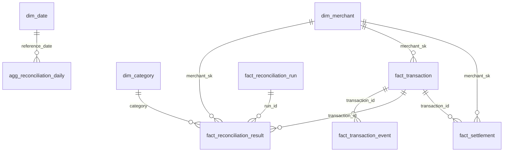

# Gold layer

Gold turns the Silver entities into a dimensional model and into the KPIs of
[`data-product.md`](data-product.md): facts and dimensions that cross entities, plus small daily
aggregates per consumer. It is built by `etl_jobs/gold/build_gold.py` with SQL in DuckDB and
published as Delta tables in `data/gold/`. The questions each table answers, with the queries and
their results on the challenge sample, are in [`analytics.md`](analytics.md).

- [1. Model](#1-model)
- [2. Tables](#2-tables)
- [3. Business rules](#3-business-rules)
- [4. Idempotency and the reference date](#4-idempotency-and-the-reference-date)
- [5. Data quality checks](#5-data-quality-checks)
- [6. Business metrics and alerts](#6-business-metrics-and-alerts)
- [7. Example queries](#7-example-queries)
- [8. Extending Gold](#8-extending-gold)
- [9. Limits and production](#9-limits-and-production)

## 1. Model

The boundary with Silver: Silver makes each entity correct and at the right grain; Gold combines
entities and aggregates. Gold never cleans data, and Silver never computes KPIs.



Two times are kept apart everywhere: `reference_date` is business time (the day a file
represents), and `run_id` / `started_at` / `_gold_run_id` are system time. Facts keep every run,
which is what Compliance needs. The KPIs of Operations and the CFO read only the **reference run**
of each date (`is_reference_run`): the latest `COMPLETED` run of that `reference_date`.

## 2. Tables

| Table | Grain (key) | Partition | Built from | Serves |
|---|---|---|---|---|
| `dim_date` | day (`date_key`) | none (rebuilt whole) | min to max date in Silver | every daily table |
| `dim_category` | category | none | static seed | the definition of the discrepancy rate |
| `dim_merchant` | merchant version (`merchant_sk`) + `UNKNOWN` member | none | `silver.merchants` | O9, F4, C4 |
| `fact_reconciliation_run` | run (`run_id`) | `reference_date` | runs + results | O5, O6, O10, C2 |
| `fact_reconciliation_result` | verdict (`run_id`, `transaction_id`) | `reference_date` | results + runs + transactions + settlements | O1–O4, O9, C1, C2 |
| `fact_transaction_event` | CDC event (`transaction_id`, `cdc_timestamp`, `op`) | `created_date` | `silver.transactions_history` + results | C1, C3, C6 |
| `fact_transaction` | transaction (`transaction_id`), current state | `created_date` | transactions + results + events | F1–F4, F7, O7, O8, C3 |
| `fact_settlement` | settlement line (`processor`, `reference_date`, `transaction_id`, `processor_reference`) | `reference_date` | settlements + transactions | F5, F6, F7 |
| `audit_reconciliation_recheck` | (`run_id`, `transaction_id`) | `reference_date` | results + transactions + settlements | Compliance evidence, check |
| `agg_reconciliation_daily` | `reference_date` | none (rebuilt whole) | `fact_reconciliation_run` | O1–O3, O5 |
| `agg_amount_at_risk_daily` | `reference_date` × `currency` | none | `fact_reconciliation_result` | O4 |
| `agg_reconciliation_merchant` | `reference_date` × `merchant_id` | none | `fact_reconciliation_result` | O9 |
| `agg_volume_daily` | `created_date` × `currency` × `status` | none | `fact_transaction` | F1–F3 |
| `agg_merchant_volume_daily` | `created_date` × `merchant_id` × `currency` | none | `fact_transaction` | F4 |
| `agg_settlement_daily` | `settled_date` × `processor` × `currency` | none | `fact_settlement` | F5, F6 |

Every table carries `_gold_run_id` and `_gold_built_at`. Facts also keep the lineage of the source
row (`_source_file`, `_bronze_ingested_at`, `_silver_run_id`), so any Gold number can be followed
back to the Bronze file it came from (C2).

**Why a fact per run *and* a fact per transaction.** The same transaction appears in several runs,
because the 7-day windows overlap (finding 1 of `data-product.md`). Summing amounts over
`fact_reconciliation_result` therefore double counts money. Operations reads that fact per run
(`is_reference_run`); money questions read `fact_transaction`, which has one row per transaction
with its latest verdict.

**Why the aggregates are rebuilt whole.** The trend (O3) and the reference run of a date look at
other dates: rewriting date D changes the baseline of D+1 onward. The aggregates have one row per
day (or per day and merchant), so rebuilding them is cheap and never leaves a stale baseline.

## 3. Business rules

| Rule | Where | Definition |
|---|---|---|
| Discrepancy | `dim_category.is_discrepancy` | every category except `MATCHED` |
| Discrepancy rate (O1) | `fact_reconciliation_run`, `agg_reconciliation_daily` | `discrepancy_count / result_count` on the deduplicated results of the run; orphan results (Silver quarantine) excluded |
| Reference run | `fact_reconciliation_run.is_reference_run` | latest `COMPLETED` run of the `reference_date` (by `started_at`, then `run_id`); a `FAILED` rerun never replaces a completed one |
| Comparable volume | `agg_reconciliation_daily.is_comparable_volume` | a date with results is comparable when its `result_count` is at least half of `result_count_baseline`, the median result count of the previous 28 dates with results. A date with a handful of results has a meaningless rate (one result in two is 50%), so it is neither compared nor used as a baseline. The volume baseline does not depend on the rate, so the rule is not circular; a permanent drop in volume becomes the new normal after about two weeks |
| Trend (O3) | `agg_reconciliation_daily` | `discrepancy_rate_baseline` = average of the previous 5 **comparable** dates; `discrepancy_rate_deviation` = rate − baseline (positive is worse); both null for a non-comparable date |
| Expected cadence (O5) | `agg_reconciliation_daily.cadence_days` | the most common gap between run dates (3 days in the sample, 1 day in the generator); a date is expected when it falls on that cadence from the first run |
| Missing run (O5) | `is_missing_run` | expected date without a `COMPLETED` run (a failed run counts as missing) |
| Stuck run | `is_stuck` | `IN_PROGRESS` more than 24 hours before the build |
| Amount at risk (O4) | `fact_reconciliation_result.amount_at_risk` | `difference` for `MISMATCHED`, the present side for `UNRECONCILED_*`, 0 for `MATCHED` |
| Currency of a verdict | `fact_reconciliation_result.currency` | results carry no currency: taken from the internal transaction, failing that from the settlement; null otherwise (`currency_unknown` warns); amounts are always grouped by currency |
| Reconciliation status | `fact_transaction.reconciliation_status` | category in the latest run that judged the transaction, `NOT_RECONCILED` if none |
| Exposure (F7) | `fact_transaction.exposure_amount` | amount for `UNRECONCILED_INTERNAL`, difference for `MISMATCHED`, 0 otherwise or when deleted; processor-only money comes from the latest `UNRECONCILED_PROCESSOR` verdict |
| Aging (O7) | `days_unreconciled` | latest run date − creation date, for transactions still `UNRECONCILED_INTERNAL`; uses the run date, not the build date, so it is reproducible |
| Resolution (O8) | `is_resolved_discrepancy` | latest verdict `MATCHED` after a discrepancy in an earlier run |
| Change after reconciliation (C3) | `fact_transaction_event.is_after_reconciliation`, `fact_transaction.changes_after_reconciliation` | CDC event after the first verdict on the transaction that changed amount or status, or deleted it |
| Merchant at a date (C4) | `merchant_sk` in every fact | version of `dim_merchant` valid at the event (transaction creation, settlement time); the earliest version when the event predates the registry; `UNKNOWN` when the merchant is not registered |
| CNPJ | `dim_merchant` | only `document_masked` (`12.345.678/****-**`, the root identifies the company group) and `document_hash` (SHA-256 for exact matching) reach Gold |
| TPV (F1) | `agg_volume_daily` | sum of `amount` of non-deleted transactions by `created_date`, `currency` and `status`; the CFO headline is `status = 'COMPLETED'` in BRL |
| Settled net (F5) | `fact_settlement.signed_amount` | amount, negative for `REVERSED`; its sum is settled − reversed |

**Recomputing the reconciliation.** `audit_reconciliation_recheck` recomputes the verdicts of every
reference run whose date has a settlement file in Silver, with the rules of the glossary, for every
transaction the service judged in that run or that appears in the processor file of that date:

- internal side: the transaction, if not deleted and created in `[reference_date − 7, reference_date]`;
- processor side: its settlement line of that `reference_date`;
- `MATCHED` when both sides exist and differ by at most R$ 0.01, `MISMATCHED` above it,
  `UNRECONCILED_*` when one side is missing.

It is then compared with the service verdict: `outcome` is `agrees`, `category_differs`,
`missing_in_service` (a processor line the service did not judge) or `missing_in_recompute` (a
verdict with neither side found). It uses the current state of the transactions, so a later CDC
change can explain a difference; the table is evidence, not a replacement for the service.

Internal transactions of the window that the service did not judge in that run are **not** listed.
The service reports an unmatched internal transaction in one run, not in each of the eight runs
whose windows contain it; listing them multiplied the table by eight (7.7M rows for 1M
transactions) with no signal.

What it found:

| Data | Result |
|---|---|
| Synthetic 1M (`make generate-large`) | the recomputation agrees with 99.5% of the service verdicts; the rest are `MATCHED` verdicts whose internal transaction is outside the window or deleted, and ~3k `REVERSED` processor lines the service never judged (the same orphan lines behind `run_total_coherence` in Silver) |
| Challenge sample | no agreement: the only settlement file (`settlement_paysettler.csv`, 500 lines) is not the file processed by run 5 of the same date (`settlement_20250316_02_00.csv`, 98 transactions), and 592 of the 788 verdicts judge internal transactions created outside the 7-day window of their run |

The unit tests cover a coherent case where the recomputation agrees.

## 4. Idempotency and the reference date

```bash
python -m etl_jobs.gold.build_gold                                   # full rebuild
python -m etl_jobs.gold.build_gold --reference-date 2025-03-16       # one business date
python -m etl_jobs.gold.build_gold --start-date 2025-03-01 --end-date 2025-03-16
make gold                        # full rebuild, then maintenance
make gold REFERENCE_DATE=2025-03-16
make pipeline REFERENCE_DATE=2025-03-16    # Bronze, Silver and Gold for that date
```

Gold follows the mechanism of Silver ([`silver-layer.md`](silver-layer.md), section 4), with the same
shared code (`src/common/layer_build.py`):

1. each Silver table is read once, at the Delta version current when the run starts; the version is
   stored in the step `inputs` (`silver/transactions@v3`) and in the `silver_versions` commit
   metadata;
2. every Gold table is computed into DuckDB temp tables, in the order of `GOLD_TABLES`
   (`etl_jobs/gold/tables.py`);
3. the checks run; any `error` stops the run before anything is published;
4. each table replaces only the partitions in the scope of the run, with a Delta overwrite filtered
   by a predicate.

| Table | Partitions replaced for dates `[A, B]` |
|---|---|
| `fact_reconciliation_run`, `fact_reconciliation_result`, `fact_settlement`, `audit_reconciliation_recheck` | `reference_date` in `[A, B]` |
| `fact_transaction`, `fact_transaction_event` | `created_date` in `[A − 7, B]` (a run of D judges transactions created in `[D − 7, D]`) |
| dimensions and aggregates | whole table |

Running the same date twice leaves the same content; a full rebuild and any sequence of date runs
over the same Silver give the same Gold (verified on the sample and by
`test_rerun_for_the_same_reference_date_is_idempotent`). A failure before publishing writes
nothing; a failure while publishing leaves some tables replaced, and rerunning the same scope
converges.

Gold reads the **published** Silver, so the order is Bronze → Silver → Gold for the same dates
(`make pipeline`). Running Gold alone after a Silver failure republishes Gold from the last good
Silver, which is consistent but stale; the `arrival_lag_hours` and Silver run alerts are the signal.

## 5. Data quality checks

Contract checks are generated as in Silver: `not_null` for every `required` column and `unique` for
the primary key, both `error`. Custom checks are in `etl_jobs/gold/quality_checks.yml`.

| Check | Severity | What it protects |
|---|---|---|
| `row_conservation:fact_*` (5 checks) | error | each Silver row becomes exactly one fact row: no join fans out, nothing is lost |
| `sum_conservation:agg_volume_daily` | error | TPV per currency and status equals the non-deleted Silver transactions (Silver → Gold) |
| `sum_conservation:agg_settlement_daily` | error | settled and reversed amounts equal the Silver settlements |
| `sum_conservation:agg_amount_at_risk_daily` | error | amount at risk per date equals the reference-run facts |
| `relationships:fact_*.merchant_sk` (3 checks) | error | every fact points to a merchant version or the `UNKNOWN` member |
| `rate_bounds:agg_reconciliation_daily` | error | rates in `[0, 1]`; category counts add up to the result count |
| `one_reference_run:fact_reconciliation_run` | error | KPIs use exactly one run per date |
| `cnpj_masked:dim_merchant` | error | no full CNPJ reaches Gold |
| `relationships:fact_reconciliation_result.category` | warn | a category not described in `dim_category` |
| `missing_run:agg_reconciliation_daily` | warn | dates the cadence expects without a completed run |
| `currency_unknown:fact_reconciliation_result` | warn | verdicts whose money cannot be put in a currency |
| `reconciliation_recheck:audit_reconciliation_recheck` | warn | service verdicts that differ from the recomputation |

**Why these block and those warn.** As in Silver, `error` checks protect the transformation itself:
if a join duplicates rows, a sum does not match the layer below, or a sensitive value leaks, the
Gold computation is wrong and publishing it would show wrong numbers to the CFO. `warn` checks
describe the source and the business (a missing run, a service verdict that does not follow the
rules); blocking on them would leave every consumer without data because of one upstream problem,
and the dashboards themselves show the problem (`is_missing_run`, the recheck table).

Results on the data:

| Data | Findings |
|---|---|
| Challenge sample | every `error` check passes; `missing_run` warns (1: run 7 of 2025-03-22 failed); `reconciliation_recheck` warns (544 rows: 451 processor lines the service did not judge, 61 category differences, 32 verdicts with neither side; section 3) |
| Synthetic data (`make generate`) | see [`test-plan.md`](test-plan.md) section 4 |

## 6. Business metrics and alerts

After publishing, the run records business metrics in `pipeline_metrics` (`layer = gold`,
`table_name = agg_reconciliation_daily`), so the existing alert engine watches the business and not
only the pipeline:

| Metric | Value | Alert rule |
|---|---|---|
| `discrepancy_rate` | rate of the latest date with results in the scope (with `reference_date`) | none (history) |
| `discrepancy_rate_deviation` | its deviation from the baseline, only when the date has a comparable volume (otherwise logged as "not compared") | `discrepancy_rate_spike` (warn, > 5 p.p.) |
| `missing_runs` | expected dates without a completed run in the scope (all dates on a full rebuild) | `reconciliation_runs_missing` (warn, > 0) |

Plus the generic ones of every layer: `rows_out` per table and `table_row_count`,
`table_file_count`, `table_size_bytes`.

## 7. Example queries

17 queries in `etl_jobs/gold/queries/<consumer>/NN_<question>.sql` (Operations, CFO, Compliance).
They run against the Gold tables only:

```bash
make queries                         # all, results in data/reports/gold_queries.md
make queries CONSUMER=cfo
python -m etl_jobs.gold.run_queries --consumer compliance --max-rows 50 --output out.md
```

`test_run_queries.py` runs every shipped query against a Gold built from the test fixtures, so a
model change that breaks a query fails the tests. The questions, the reasoning and the results on
the sample are in [`analytics.md`](analytics.md).

## 8. Extending Gold

- **A new Gold table:** add `sql/<table>.sql`, `contracts/<table>.yml` and an entry in
  `GOLD_TABLES` (`etl_jobs/gold/tables.py`) with its Silver inputs, partition column and lookback.
  A table can read every temp table computed before it. Add its Z-order columns to `GOLD_ZORDER`
  (`etl_jobs/maintenance/optimize_tables.py`). If it feeds a P0 KPI directly, declare
  `customProperties: [{property: critical, value: true}]` in its contract. Run `make lineage`
  ([`lineage.md`](lineage.md) is checked by the tests).
- **A new question:** a `.sql` file in `etl_jobs/gold/queries/<consumer>/`; the test runs it.
- **A second settlement processor:** nothing changes in Gold. `fact_settlement` and
  `agg_settlement_daily` already have `processor` in their key, and the recheck reads every
  settlement of the date.
- **A new reconciliation category:** add a row to `dim_category.sql`; until then the
  `relationships:...category` check warns and the category counts as a discrepancy.

## 9. Limits and production

- **Whole Silver in memory.** Like Silver, every run reads all of Silver and computes the whole
  layer, then publishes only the scope. The production evolution is the same: prune the Silver scan
  by partition (`[D − 7, D]` for transactions, `D` for runs and results) and `MERGE` into
  `fact_transaction` instead of rebuilding it.
- **Aggregates rebuilt whole.** Cheap at one row per day; at years of history they would be
  rebuilt only from the earliest date affected by the run.
- **Trend and cadence are simple statistics.** A 5-date moving average, a volume guard (half of the
  28-date median) and the most common gap.
  Seasonality (weekends, month end) and a calendar of expected runs per processor would come from
  a business calendar in production.
- **The recheck uses current state.** A faithful recomputation needs the transactions as they were
  when the run happened (`fact_transaction_event` as of `started_at`) and the exact file of the run.
- **No serving layer.** Consumers query Delta through DuckDB (`make ui`, `make queries`). Production
  would expose Gold through a warehouse or semantic layer with access control per consumer (the
  masked CNPJ is the minimum, not a policy).
