# Lineage

Generated by `make lineage` (`etl_jobs/observability/lineage.py`); do not edit by hand.
`test_lineage.py` fails when this file is out of date.

- **Dependencies** come from the SQL of each Silver and Gold table: a reference to `bronze_<table>` or
  `silver_<table>` is a dependency on the previous layer, a reference to another table of the same
  layer is a dependency inside the layer. Bronze tables are the datasets of the Bronze contracts.
- **Critical** tables are declared in their contract (`customProperties: [{property: critical,
  value: true}]`): they feed a P0 KPI directly. Tables upstream of a critical table are derived.
- `python -m etl_jobs.observability.lineage --impact silver.settlements` lists what a failure of a
  table affects.

Legend: red = critical, yellow = feeds a critical table, dashed = temporary step (not published).

```mermaid
flowchart LR
    subgraph bronze
        bronze__enterprise_company["enterprise_company"]
        bronze__reconciliation_results["reconciliation_results"]
        bronze__reconciliation_runs["reconciliation_runs"]
        bronze__settlement_paysettler["settlement_paysettler"]
        bronze__transactions["transactions"]
    end
    subgraph silver
        silver__merchants["merchants"]
        silver__reconciliation_results["reconciliation_results"]
        silver__reconciliation_results_deduped["reconciliation_results_deduped (temp)"]
        silver__reconciliation_results_quarantine["reconciliation_results_quarantine"]
        silver__reconciliation_runs["reconciliation_runs"]
        silver__settlements["settlements"]
        silver__transactions["transactions"]
        silver__transactions_history["transactions_history"]
    end
    subgraph gold
        gold__agg_amount_at_risk_daily["agg_amount_at_risk_daily"]
        gold__agg_merchant_volume_daily["agg_merchant_volume_daily"]
        gold__agg_reconciliation_daily["agg_reconciliation_daily"]
        gold__agg_reconciliation_merchant["agg_reconciliation_merchant"]
        gold__agg_settlement_daily["agg_settlement_daily"]
        gold__agg_volume_daily["agg_volume_daily"]
        gold__dim_category["dim_category"]
        gold__dim_date["dim_date"]
        gold__dim_merchant["dim_merchant"]
        gold__fact_reconciliation_result["fact_reconciliation_result"]
        gold__fact_reconciliation_run["fact_reconciliation_run"]
        gold__fact_settlement["fact_settlement"]
        gold__fact_transaction["fact_transaction"]
        gold__fact_transaction_event["fact_transaction_event"]
    end
    bronze__enterprise_company --> silver__merchants
    bronze__reconciliation_results --> silver__reconciliation_results_deduped
    bronze__reconciliation_runs --> silver__reconciliation_runs
    bronze__settlement_paysettler --> silver__settlements
    bronze__transactions --> silver__transactions_history
    gold__dim_category --> gold__fact_reconciliation_result
    gold__dim_date --> gold__agg_reconciliation_daily
    gold__dim_merchant --> gold__agg_reconciliation_merchant
    gold__dim_merchant --> gold__fact_reconciliation_result
    gold__dim_merchant --> gold__fact_settlement
    gold__dim_merchant --> gold__fact_transaction
    gold__fact_reconciliation_result --> gold__agg_amount_at_risk_daily
    gold__fact_reconciliation_result --> gold__agg_reconciliation_merchant
    gold__fact_reconciliation_run --> gold__agg_reconciliation_daily
    gold__fact_reconciliation_run --> gold__fact_reconciliation_result
    gold__fact_settlement --> gold__agg_settlement_daily
    gold__fact_transaction --> gold__agg_merchant_volume_daily
    gold__fact_transaction --> gold__agg_volume_daily
    gold__fact_transaction_event --> gold__fact_transaction
    silver__merchants --> gold__dim_merchant
    silver__reconciliation_results --> gold__fact_reconciliation_result
    silver__reconciliation_results --> gold__fact_reconciliation_run
    silver__reconciliation_results --> gold__fact_transaction
    silver__reconciliation_results --> gold__fact_transaction_event
    silver__reconciliation_results_deduped --> silver__reconciliation_results
    silver__reconciliation_results_deduped --> silver__reconciliation_results_quarantine
    silver__reconciliation_runs --> gold__dim_date
    silver__reconciliation_runs --> gold__fact_reconciliation_run
    silver__reconciliation_runs --> gold__fact_transaction
    silver__reconciliation_runs --> silver__reconciliation_results
    silver__reconciliation_runs --> silver__reconciliation_results_quarantine
    silver__settlements --> gold__dim_date
    silver__settlements --> gold__fact_reconciliation_result
    silver__settlements --> gold__fact_settlement
    silver__settlements --> silver__reconciliation_results_deduped
    silver__transactions --> gold__dim_date
    silver__transactions --> gold__fact_reconciliation_result
    silver__transactions --> gold__fact_settlement
    silver__transactions --> gold__fact_transaction
    silver__transactions --> silver__reconciliation_results_deduped
    silver__transactions_history --> gold__fact_transaction_event
    silver__transactions_history --> silver__transactions
    classDef critical fill:#f8d7da,stroke:#b02a37,stroke-width:2px,color:#000
    classDef feeds fill:#fff3cd,stroke:#997404,color:#000
    classDef temp stroke-dasharray:4 3
    class gold__agg_amount_at_risk_daily,gold__agg_reconciliation_daily,gold__agg_volume_daily,gold__fact_reconciliation_result,gold__fact_reconciliation_run,gold__fact_transaction,gold__fact_transaction_event critical
    class bronze__enterprise_company,bronze__reconciliation_results,bronze__reconciliation_runs,bronze__settlement_paysettler,bronze__transactions,gold__dim_category,gold__dim_date,gold__dim_merchant,silver__merchants,silver__reconciliation_results,silver__reconciliation_results_deduped,silver__reconciliation_runs,silver__settlements,silver__transactions,silver__transactions_history feeds
    class silver__reconciliation_results_deduped temp
```

| Critical table | Upstream tables |
|---|---|
| `gold.agg_amount_at_risk_daily` | 16 |
| `gold.agg_reconciliation_daily` | 12 |
| `gold.agg_volume_daily` | 15 |
| `gold.fact_reconciliation_result` | 15 |
| `gold.fact_reconciliation_run` | 10 |
| `gold.fact_transaction` | 14 |
| `gold.fact_transaction_event` | 10 |
