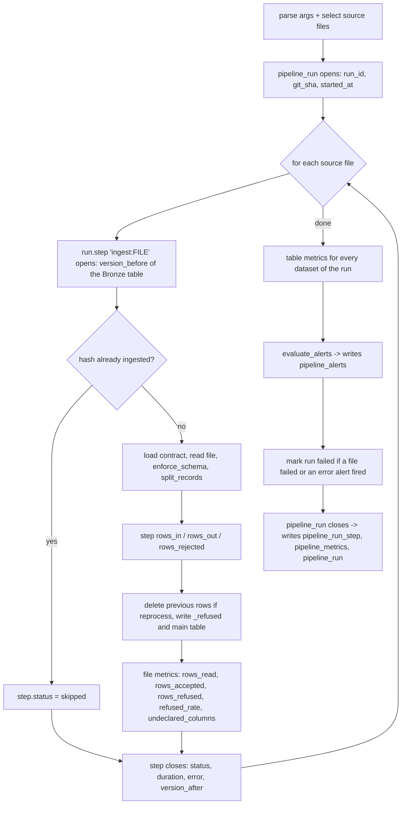

# Pipeline observability

Every job run leaves a structured, queryable trail: what it read and wrote, where it stopped, and
whether the numbers look normal. The component lives in `src/observability/` and writes four Delta
tables. This document lists where they are stored, when the Bronze pipeline writes each record,
every metric available and the questions each one answers.

- [1. Where the data is stored](#1-where-the-data-is-stored)
- [2. When it is written in the Bronze pipeline](#2-when-it-is-written-in-the-bronze-pipeline)
- [3. Metrics catalog](#3-metrics-catalog)
- [4. Tables: columns and questions they answer](#4-tables-columns-and-questions-they-answer)
- [5. Alerts: what stops and what only warns](#5-alerts-what-stops-and-what-only-warns)
- [6. Health report](#6-health-report)
- [7. Debugging recipes](#7-debugging-recipes)
- [8. Limits and production](#8-limits-and-production)

## 1. Where the data is stored

| Table | Physical path (Delta) | DuckDB UI (`make ui`) | Grain |
|---|---|---|---|
| `pipeline_run` | `data/observability/pipeline_run` | `observability.pipeline_run` | one row per job execution |
| `pipeline_run_step` | `data/observability/pipeline_run_step` | `observability.pipeline_run_step` | run × step |
| `pipeline_metrics` | `data/observability/pipeline_metrics` | `observability.pipeline_metrics` | run × table × metric (× source file) |
| `pipeline_alerts` | `data/observability/pipeline_alerts` | `observability.pipeline_alerts` | run × evaluated rule × metric row |

- The path comes from `OBSERVABILITY_DIR` in `src/utils/paths.py`. Schemas are fixed in
  `src/observability/store.py` (`SCHEMAS`).
- All four tables are append-only, use the same retention properties as Bronze and are compacted by
  `make optimize`.
- In the DuckDB UI, `run_duckdb_ui.py` registers each Delta table as a view in the `observability`
  schema, next to `bronze`, `silver` and `gold`.
- Reports generated from these tables go to `data/observability/reports/` (section 6).

**One `run_id` links everything:** the four tables above, the `_run_id` column of every Bronze row
(main and `_refused` tables) and the `run_id` in the Delta commit metadata of every Bronze write or
delete. From any Bronze row you can reach its run, step, source file and metrics.

## 2. When it is written in the Bronze pipeline

`make bronze` runs two jobs in sequence, each one a separate run:

1. `etl_jobs/bronze/ingest_to_bronze.py`: job `bronze.ingest`, mode `ingest` (`reprocess` with
   `make reprocess`).
2. `etl_jobs/maintenance/optimize_tables.py`: job `maintenance.optimize`, mode `maintenance`.

`make reprocess` runs the same two jobs. `make optimize` runs only the second.

### 2.1 Ingestion run (`bronze.ingest`)



| # | Moment in `ingest_to_bronze.py` | Call | What is recorded | Persisted in |
|---|---|---|---|---|
| 1 | Start of `main`, after the source files are selected | `pipeline_run("bronze.ingest", mode, OBSERVABILITY_DIR)` | `run_id`, `git_sha` (from `GIT_SHA`), `started_at` | `pipeline_run` at the end of the run |
| 2 | Start of `ingest_file`, one per source file | `run.step("ingest:<file>", "bronze", dataset, output_table, [source])` | `started_at`, `version_before` of `data/bronze/<dataset>` | `pipeline_run_step` at the end of the run |
| 3 | File already ingested (same SHA-256), regular mode only | `step.status = "skipped"` | step without row counts | `pipeline_run_step` |
| 3b | After the contract is loaded | `step.contract_version = contract["version"]` | contract version used for this file | `pipeline_run_step` and the Delta commit metadata |
| 4 | After `enforce_schema` + `split_records` | `step.rows_in/rows_out/rows_rejected` | rows read, accepted and refused | `pipeline_run_step` |
| 5 | After the writes to `_refused` and the main table | `run.metric(..., source_file=<file>)` | the 5 **file metrics** (section 3.1) | `pipeline_metrics` |
| 6 | Step exits (success, skip or exception) | `run.step` `finally` | `status`, `ended_at`, `duration_s`, `error`, `version_after`; logs `Step <step> finished with status <status> in <s>s` | `pipeline_run_step` |
| 7 | After all files | `record_table_metrics(run, expected_datasets(sources))` | the **table metrics** (section 3.2) of `<dataset>` and `<dataset>_refused`, for **every dataset with a contract** plus any dataset found in the landing folder | `pipeline_metrics` |
| 8 | After the table metrics | `evaluate_alerts(run, load_rules(ALERT_RULES_FILE))` | one row per rule × matching metric | `pipeline_alerts` (immediately) |
| 9 | Before the run closes | `run.mark_failed(...)` | `status = failed` and the reason, if a file failed and/or an `error` alert fired | `pipeline_run` |
| 10 | `pipeline_run` exits (also on exception) | `pipeline_run` `finally` | `ended_at`, `duration_s`, final `status` and `error`; logs `Run <run_id> (<job>) finished with status <status> in <s>s (<n> steps)` | `pipeline_run_step`, `pipeline_metrics`, `pipeline_run` |

Details that matter when reading the data:

- **Buffered writes.** Steps and metrics are kept in memory and written once when the run closes
  (step 10): one commit per table per run. Alerts are written in step 8. A Python exception still
  goes through the `finally`, so it is recorded; only a hard kill of the process loses the run.
- **Delta versions are cached per run.** `version_before` is read once per table and then kept in
  memory; it is reloaded only after a step that may have written (`success` or `failed`), and a
  `skipped` step reuses it. Only the run itself writes to its tables, so the cache stays exact and a
  run that skips every file opens each table once instead of twice per file.
- **Failed file.** If a file raises (for example a schema break), its step is `failed` with the
  exception text, and step 5 never runs: there are **no file metrics** for it. The other files
  continue, and the run ends `failed` with exit code 1.
- **Skipped file.** No file metrics, but the table metrics of its dataset are still computed
  (step 7), because they describe the table, not the file.
- **Source that stopped sending.** Table metrics cover every dataset that has a contract, even with
  no file in the landing folder, so `arrival_lag_hours` keeps growing and the overdue rules fire
  (section 5).
- **Invalid arguments** (unknown file in `--reprocess`, `--reason` without `--reprocess`) stop the
  job before step 1: nothing ran, so nothing is recorded.

### 2.2 Maintenance run (`maintenance.optimize`)

| Moment in `optimize_tables.py` | Call | What is recorded |
|---|---|---|
| Start of `main` | `pipeline_run("maintenance.optimize", "maintenance", OBSERVABILITY_DIR)` | the run |
| One per Bronze table (`BRONZE_ZORDER`) and observability table (`OBSERVABILITY_ZORDER`) | `run.step("optimize:<table>", layer, table, path, [path])` | step `skipped` if the table does not exist; `failed` with the error if maintenance raises (the other tables continue) |
| After `maintain_table` succeeds | `run.metric(layer, table, ...)` | the 3 **maintenance metrics** (section 3.3) |

No alert rules are evaluated in the maintenance run today.

## 3. Metrics catalog

All metrics go to `pipeline_metrics` with `layer`, `table_name`, `metric` and `value` (always a
`double`). `source_file` is filled only for file metrics. `reference_date` is reserved for
Silver/Gold partitions and is null in Bronze.

### 3.1 File metrics: one set per ingested source file

Recorded in step 5 of section 2.1, with `table_name = <dataset>` and `source_file = <file name>`.

| Metric | Unit | How it is computed | Question it answers | Alert rule |
|---|---|---|---|---|
| `rows_read` | rows | rows in the file after reading | Did the file arrive complete? Is today's volume in line with recent files? | `rows_read_deviation` (warn) |
| `rows_accepted` | rows | rows that passed the contract, written to `data/bronze/<dataset>` | Did the file produce any usable data? | `no_rows_accepted` (error) |
| `rows_refused` | rows | rows sent to `data/bronze/<dataset>_refused` | How many rows went to the dead letter table? | (via `refused_rate`) |
| `refused_rate` | fraction 0–1 | `rows_refused / rows_read` (0 for an empty file) | Is this normal dirty data or a producer problem? Is it trending up? | `refused_rate_elevated` (warn), `refused_rate_high` (error) |
| `undeclared_columns` | columns | columns in the file that are not in the contract (kept and written) | Did the producer add a column we should add to the contract? | `undeclared_columns` (warn) |

### 3.2 Table metrics: one set per Bronze table touched by the run

Recorded in step 7 of section 2.1 (`src/observability/metrics.py`, `table_metrics`) for
`<dataset>` and, if it exists, `<dataset>_refused`. `source_file` is null.

| Metric | Unit | How it is computed | Question it answers | Alert rule |
|---|---|---|---|---|
| `table_row_count` | rows | rows in the current Delta version | How big is the table? Did a reprocess keep the expected total? | none |
| `table_file_count` | files | data files in the current Delta version | Is the table fragmenting into small files? Is maintenance keeping up? | `too_many_files` (warn) |
| `table_size_bytes` | bytes | sum of the data file sizes | How fast is storage growing? | none |
| `freshness_lag_hours` | hours | now − latest **event** timestamp (business time); main table only | How old is the newest business event in the table? | none (see section 5) |
| `arrival_lag_hours` | hours | now − latest `_ingested_at` (when the last new file was loaded); main table only | Has the source stopped delivering? Since when has nothing new arrived ("no data since Friday")? | `settlement_file_overdue`, `reconciliation_run_overdue` (error), `transactions_stale` (warn) |

Event column used for freshness: `settled_at` for `settlement_paysettler`, `_timestamp` (CDC event
time) for the other datasets (`EVENT_COLUMNS` / `DEFAULT_EVENT_COLUMN` in `ingest_to_bronze.py`).
Values that do not parse as a timestamp are ignored; if the column is missing, the metric is not
recorded.

### 3.3 Maintenance metrics: one set per optimized table

Recorded by `maintenance.optimize` for each Bronze and observability table that exists, with
`layer` = `bronze` or `observability`.

| Metric | Unit | How it is computed | Question it answers |
|---|---|---|---|
| `files_added` | files | files written by OPTIMIZE (Z-order or compaction); 0 when skipped because nothing changed | Did maintenance actually rewrite the table? |
| `files_removed` | files | files replaced by OPTIMIZE | How fragmented was the table before? |
| `files_vacuumed` | files | expired files physically deleted by VACUUM | Is old data being cleaned up per the retention policy? |

## 4. Tables: columns and questions they answer

### `pipeline_run`

| Column | Meaning |
|---|---|
| `run_id` | run identifier (hex UUID) |
| `job` | `bronze.ingest` or `maintenance.optimize` |
| `mode` | `ingest`, `reprocess` or `maintenance` |
| `status` | `success` or `failed` |
| `started_at`, `ended_at`, `duration_s` | timing (UTC) |
| `git_sha` | code version: `git describe --always --dirty` passed by `make` as `GIT_SHA` (e.g. `6daee46`, or `6daee46-dirty` when the run used uncommitted changes and cannot be reproduced from the commit alone); `unknown` when not provided |
| `error` | why the run failed (failed files and/or blocking alerts, or the exception) |

Answers: did the last run succeed? Since when has the pipeline been failing ("no data since
Friday")? Which code version produced this data? Was this load a reprocess? Are runs getting slower?

### `pipeline_run_step`

| Column | Meaning |
|---|---|
| `run_id`, `step`, `layer`, `dataset` | which run, which step (`ingest:<file>` / `optimize:<table>`), where |
| `source_file`, `inputs` | file processed and its full input path(s) |
| `contract_version` | `version` of the data contract the file was validated with (null when the step was skipped before loading the contract) |
| `output_table` | Delta table written |
| `version_before`, `version_after` | Delta versions of `output_table` around the step |
| `rows_in`, `rows_out`, `rows_rejected` | rows read, written to the main table, sent to `_refused` |
| `status` | `success`, `skipped` or `failed` |
| `started_at`, `ended_at`, `duration_s` | timing |
| `error` | exception type and message when `failed` |

Answers: where did the run stop and why? Which file broke the schema? Which contract version
validated this file (and therefore which files to reprocess after a contract change)? Did rows disappear between
input and output (`rows_in ≠ rows_out + rows_rejected`)? Which Delta version should I time-travel
to in order to see the table before this step? Which step is slow?

### `pipeline_metrics`

| Column | Meaning |
|---|---|
| `run_id`, `layer`, `table_name`, `source_file` | where the metric comes from |
| `metric`, `value` | metric name (section 3) and value |
| `reference_date` | business date (Silver/Gold); null in Bronze |
| `computed_at` | when it was computed (UTC) |

Answers: is the refusal rate trending up? Is today's file much smaller than usual? Is a table
fragmenting? How fresh is the data? It is also the baseline for deviation alerts and for the
"median" column of the report.

### `pipeline_alerts`

| Column | Meaning |
|---|---|
| `run_id`, `rule` | run and rule name (from `alert_rules.yml`) |
| `layer`, `table_name`, `source_file`, `metric`, `value` | the metric row the rule was evaluated on |
| `expected` | threshold (threshold rules) or historical median (deviation rules) |
| `severity` | `warn` or `error`, as configured |
| `status` | `pass`, `warn` or `fail` |
| `message` | human-readable explanation |
| `evaluated_at` | when it was evaluated (UTC) |

Answers: why did the run fail or warn? Which checks passed, as evidence that controls ran (useful
for Compliance)? How often does a rule fire over time?

## 5. Alerts: what stops and what only warns

Rules live in `etl_jobs/observability/alert_rules.yml` (loaded by `ALERT_RULES_FILE`) and are
evaluated in step 8 of the ingestion run (`src/observability/alerts.py`):

| Rule | Type | Condition | Severity | Why |
|---|---|---|---|---|
| `refused_rate_high` | threshold | `refused_rate > 0.10` | **error** | Most of a file breaking the contract is a producer problem, not dirty data |
| `refused_rate_elevated` | threshold | `refused_rate > 0.01` | warn | Above the expected level of dirty data; investigate the DLQ |
| `no_rows_accepted` | threshold | `rows_accepted == 0` | **error** | A new file produced nothing usable |
| `undeclared_columns` | threshold | `undeclared_columns > 0` | warn | Producer added a column; update the contract |
| `too_many_files` | threshold | `table_file_count > 50` | warn | Too many small files; maintenance is not keeping up |
| `rows_read_deviation` | deviation | more than 50% away from the median of the last 7 values, after 3 values of history | warn | Truncated or duplicated file |
| `settlement_file_overdue` | threshold | `arrival_lag_hours > 24` on `settlement_paysettler` | **error** | The PaySettler file is daily; a full day without a new file means the reconciliation input is missing |
| `reconciliation_run_overdue` | threshold | `arrival_lag_hours > 24` on `reconciliation_runs` | **error** | The reconciliation service runs daily; no new run means Operations dashboards go stale |
| `transactions_stale` | threshold | `arrival_lag_hours > 24` on `transactions` | warn | CDC batches stopped arriving; investigate before it affects the 7-day window |

- **threshold:** `metric operator value`.
- Any rule can be restricted to a `layer` and/or a single `table_name` (used by the overdue rules,
  since each source has its own cadence).
- **deviation:** `|value − median(last window values)| / median > max_ratio`, only after
  `min_history` previous values of the same layer/table/metric. Before that the rule passes with
  "insufficient history".
- `warn` is logged as WARNING and stored with status `warn`. `error` is logged as ERROR, stored as
  `fail` and makes the job end with **exit code 1** (run `failed`), which stops `make bronze` and
  anything chained after it.
- Data already written by the run stays in Bronze (append-only, traceable by `run_id`). The exit code
  is what keeps downstream layers from consuming it.
- **Why arrival and not event freshness.** A rule like "a run with no new file is an error" would
  break idempotency (a rerun legitimately skips everything), and event dates (`settled_at`,
  `_timestamp`) of the synthetic data are in 2025, so a rule on `freshness_lag_hours` would always
  fire. `arrival_lag_hours` measures operational delivery: it is unaffected by reruns and grows only
  while nothing new is loaded. Business-date freshness (e.g. "is there a settlement file for
  yesterday's `reference_date`?") belongs to Silver, where `reference_date` exists.
- `enterprise_company` has no arrival rule: the merchant registry changes rarely, so a quiet day is
  normal.

## 6. Health report

```bash
make report                                                     # latest run of each job
python -m etl_jobs.observability.health_report --run-id <run_id> --last 20
```

The report is generated from the four tables (`src/observability/report.py`) as Markdown in
`data/observability/reports/`:

- **Default:** `health_<UTC timestamp>.md` plus a copy in `latest.md`.
- **With `--run-id`:** `health_<run_id>.md`, and `latest.md` is left untouched.

For each job it shows the run summary, the steps (rows in/out, refused, Delta versions, errors), the
non-passing alerts and the run metrics next to the median of the previous 7 values. It ends with the
last N runs, with failed steps and refused rows.

## 7. Debugging recipes

Run these in the DuckDB UI (`make ui`):

```sql
-- Where did the last failed runs stop?
SELECT s.step, s.error
FROM observability.pipeline_run r JOIN observability.pipeline_run_step s USING (run_id)
WHERE r.status = 'failed' AND s.status = 'failed'
ORDER BY r.started_at DESC LIMIT 5;

-- Did rows disappear between input and output?
SELECT run_id, step, rows_in, rows_out, rows_rejected, rows_in - rows_out - rows_rejected AS lost
FROM observability.pipeline_run_step
WHERE rows_in IS NOT NULL AND rows_in <> rows_out + rows_rejected;

-- Refused-rate trend per dataset
SELECT r.started_at, m.table_name, m.source_file, m.value
FROM observability.pipeline_metrics m JOIN observability.pipeline_run r USING (run_id)
WHERE m.metric = 'refused_rate' ORDER BY r.started_at;

-- From a Bronze row to its run and step
SELECT r.job, r.mode, r.git_sha, s.step, s.version_before, s.version_after
FROM bronze.transactions t
JOIN observability.pipeline_run r ON r.run_id = t._run_id
JOIN observability.pipeline_run_step s ON s.run_id = t._run_id AND s.source_file = t._source_file
WHERE t.transaction_id = '<uuid>';
```

## 8. Limits and production

- No lock between concurrent runs; the orchestrator must run one job instance at a time.
- No lineage server or UI: the run/step tables cover execution lineage for this scope. In production
  the orchestrator (Airflow/Dagster) would emit OpenLineage events, and alerts would go to a channel
  (Slack/PagerDuty) instead of only logs and the report.
- `VACUUM` retention (30 days) also limits time travel to the versions referenced in
  `pipeline_run_step`.
