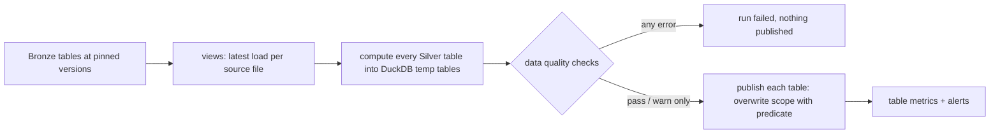

# Silver layer

Silver turns the append-only Bronze tables into typed, deduplicated and conformed tables, one per
business entity, that the Gold models and the KPIs of [`data-product.md`](data-product.md) read
from. It is built by `etl_jobs/silver/build_silver.py` with SQL in DuckDB and published as Delta
tables in `data/silver/`.

- [1. Tables](#1-tables)
- [2. Cleaning and normalization](#2-cleaning-and-normalization)
- [3. CDC and deduplication rules](#3-cdc-and-deduplication-rules)
- [4. Idempotency and the reference date](#4-idempotency-and-the-reference-date)
- [5. Compute, check, publish](#5-compute-check-publish)
- [6. Output contracts](#6-output-contracts)
- [7. Data quality checks](#7-data-quality-checks)
- [8. Extending Silver](#8-extending-silver)
- [9. Limits and production](#9-limits-and-production)

## 1. Tables

| Table | Grain (key) | Partition | Built from | Main rule |
|---|---|---|---|---|
| `transactions_history` | one CDC event (`transaction_id`, `cdc_timestamp`, `op`) | `created_date` | `transactions` | every event typed; exact replays collapsed; audit trail (C1, C3) |
| `transactions` | one transaction (`transaction_id`) | `created_date` | `transactions_history` | latest event is the current state; deletes kept with `is_deleted` |
| `settlements` | one settlement line (`processor`, `reference_date`, `transaction_id`, `processor_reference`) | `reference_date` | `settlement_paysettler` | amounts, timestamps and merchants normalized; `reference_date` from the file name |
| `reconciliation_runs` | one run (`run_id`) | `reference_date` | `reconciliation_runs` | latest CDC version; `duration_s` |
| `reconciliation_results` | one verdict (`run_id`, `transaction_id`) | `reference_date` of the run | `reconciliation_results` + runs | deduplicated; linked to the run (`reference_date`, `file_name`); merchant filled when missing |
| `reconciliation_results_quarantine` | one verdict without a run (`run_id`, `transaction_id`) | none (rebuilt whole) | same | results whose `run_id` does not exist; `_quarantine_reason = run_not_found` |
| `merchants` | one merchant version (`merchant_id`, `valid_from`) | none (rebuilt whole) | `enterprise_company` | type 2 SCD: `valid_from`, `valid_to`, `is_current`, `is_deleted` |

`reconciliation_results_deduped` is an internal step (a temporary table, never published) shared by
the results and the quarantine.

Every table carries lineage columns: `_source_file`, `_bronze_run_id` and `_bronze_ingested_at`
(from Bronze), `_silver_run_id` and `_silver_built_at` (from the Silver run). `_bronze_run_id` is
lineage only and never part of a key, because it changes when Bronze reprocesses a file.

**Why quarantine instead of a flag.** A result without a run has no `reference_date`, so it cannot
belong to any partition of `reconciliation_results` and would break the date scope. Keeping it in
a sibling table mirrors the `_refused` tables of Bronze, keeps it out of every KPI by construction
and lets the `relationships` check count it. As soon as the run arrives in Bronze, the next build
moves the rows into `reconciliation_results`.

## 2. Cleaning and normalization

Shared SQL macros live in `etl_jobs/silver/sql/macros.sql`.

| Macro | Applied to | Rule |
|---|---|---|
| `parse_ts_utc` | every timestamp (ISO 8601 text in Bronze) | values with `Z` or an offset are converted to UTC; values without a timezone are read as UTC (glossary: dates are UTC); unparseable values become null and are caught by `not_null` |
| `parse_amount` | `settlements.amount` (text in Bronze) | `152.30`, `152,30` and `R$ 1.152,30` → `DECIMAL(18,2)`; the original text is kept in `amount_raw` |
| `to_money` | amounts that are `double` in Bronze | rounded to 2 decimals and cast to `DECIMAL(18,2)`, so the R$ 0.01 tolerance is compared exactly |
| `norm_merchant` | every `merchant_id` | trimmed and upper-cased (the processor sends `merch_001`); empty becomes null |
| `norm_code` | currency, status, category | trimmed and upper-cased |
| `file_date` | settlement `_source_file` | date in the file name (`settlement_2025-03-16.csv`, `settlement_20250304_02_00.csv`) |

Other rules:

- `merchants.document` keeps only the CNPJ digits. It is sensitive and must be masked before
  reaching broad audiences (Gold).
- `transactions.payment_method` is lower-cased. When the column is absent from a Bronze snapshot
  (batches before the schema drift), the Bronze view adds it as null, based on the Bronze contract.
- A settlement file without a date in its name (the challenge sample `settlement_paysettler.csv`)
  takes `reference_date = max(settled_at)` of the file. The check
  `settled_outside_reference_date` reports lines whose settlement date differs.
- `reconciliation_results.merchant_id` is null in some source rows (16 in the sample). Silver fills
  it from the internal transaction and, failing that, from the settlement, and records where it
  came from in `merchant_id_origin` (`result`, `transaction`, `settlement`). Without this, the
  merchant hotspots (O9) would lose those rows.
- Amounts are never converted between currencies; `currency` is kept on every amount.

## 3. CDC and deduplication rules

Before anything else, each Bronze table is read through a view that keeps **only the latest load
of each source file** (`_ingested_at = max(_ingested_at)` per `_source_file`). A file resent with a
new content (new hash) without `--reprocess` therefore gives the same Silver as a reprocess.

| Table | Rows that compete | Winner (deterministic tie-break) |
|---|---|---|
| `transactions_history` | same `transaction_id`, `_timestamp` and `Op` (exact replay) | `_source_file` desc, `id` desc |
| `transactions` | all events of a `transaction_id` | `_timestamp` desc, then `Op` (D > U > I), `_source_file` desc, `id` desc |
| `settlements` | same `processor`, `reference_date`, `transaction_id`, `processor_reference` | `_source_file` desc, `settled_at` desc |
| `reconciliation_runs` | all events of a run `id` | `_timestamp` desc, then `Op`, `_source_file` desc |
| `reconciliation_results` | same `run_id` and `transaction_id` | `_timestamp` desc, then `Op`, `_source_file` desc, `id` desc |
| `merchants` | same merchant and `_timestamp` | `Op`, `_source_file` desc, `id` desc; then consecutive versions with the same attributes are collapsed |

The tie-break never depends on read order, so a rerun picks the same row. `cdc_event_count` and
`source_row_count` keep how many rows competed, as evidence for audit.

## 4. Idempotency and the reference date

```bash
python -m etl_jobs.silver.build_silver                                   # full rebuild
python -m etl_jobs.silver.build_silver --reference-date 2025-03-16       # one business date
python -m etl_jobs.silver.build_silver --start-date 2025-03-01 --end-date 2025-03-16
make silver                      # full rebuild, then maintenance
make silver REFERENCE_DATE=2025-03-16
```

Every run computes the whole layer from Bronze and then **replaces** only the partitions in its
scope, with a Delta overwrite filtered by a predicate (`replaceWhere`). One table is one atomic
commit. Running the same date twice leaves the same content (same keys, same values; only
`_silver_run_id` and `_silver_built_at` change).

| Table | Partitions replaced for dates `[A, B]` | Why |
|---|---|---|
| `settlements`, `reconciliation_runs`, `reconciliation_results` | `reference_date` in `[A, B]` | they belong to a business date |
| `transactions`, `transactions_history` | `created_date` in `[A − 7, B]` | the reconciliation of date D reads transactions created in `[D − 7, D]` (glossary); a CDC change on day T affects reconciliations T..T+7 |
| `merchants`, `reconciliation_results_quarantine` | whole table | small, no business date |
| any table, full rebuild | whole table | default when no date is given |

Delta refuses a write whose rows fall outside the predicate, so a bug in the scope cannot overwrite
other dates. A scope with no rows (for example a date whose run failed) empties those partitions,
which is the correct state.

**Bronze version pinning.** Each Bronze table is read once, at the Delta version current when the
run starts; the version is stored in the step `inputs` (`bronze/transactions@v12`) and in the
`bronze_versions` commit metadata of each Silver write. Rebuilding with the same Bronze versions
gives the same Silver.

**Failure in the middle.** Failures before the publish phase (read, compute, checks) write nothing.
A failure while publishing leaves some tables already replaced, each one internally consistent; the
run is `failed` (exit code 1) and rerunning the same scope converges, because every publish is a
replacement, never an append.

## 5. Compute, check, publish



The checks run on the computed tables before anything reaches `data/silver`, so consumers never
see a version that broke a blocking rule. `warn` results are recorded in `dq_results` and logged,
and publishing continues.

## 6. Output contracts

Each published table has an ODCS contract in `etl_jobs/silver/contracts/<table>.yml`, validated
like the Bronze ones (`test_contract_file_validator.py`). Before writing, `conform` in
`build_silver.py`:

- refuses columns not declared in the contract;
- checks every column type with `enforce_schema` (`timestamp` = UTC microseconds,
  `decimal(18,2)`, `date`, `bigint`, `boolean`, `double`, `varchar`);
- writes the columns in contract order.

The contract also drives the generic checks: every `required: true` column gets a `not_null`
check, and the `primaryKey` columns get a `unique` check, both `error`.

## 7. Data quality checks

Implemented in `src/data_quality/checks.py`. Each check is a DuckDB query that returns the number
of failing rows; a check passes when that number is within its `threshold` (0 by default).
Generic checks come from the contracts, custom ones from `etl_jobs/silver/quality_checks.yml`.

| Check | Severity | What it protects |
|---|---|---|
| `not_null:<table>:<column>` (from contracts) | error | keys, amounts and dates; a null amount after parsing means a format the parser does not know |
| `unique:<table>:<key>` (from contracts) | error | the grain of every table; a duplicate would double count KPIs |
| `row_conservation:transactions` | error | one current row per distinct Bronze `transaction_id` |
| `row_conservation:reconciliation_results` | error | every distinct Bronze verdict lands in results or quarantine |
| `row_conservation:reconciliation_runs` | error | one row per Bronze run id |
| `one_current_version:merchants` | error | at most one current version per merchant |
| `relationships:reconciliation_results.run_id` | warn | orphan results (quarantine size) |
| `relationships:transactions.merchant_id` | warn | transactions without a registered merchant |
| `relationships:reconciliation_results.transaction_id` | warn | verdicts claiming an internal side that is not in the internal records |
| `merchant_unknown:reconciliation_results` | warn | results whose merchant could not be filled |
| `category_coherence:reconciliation_results` | warn | category vs amounts, nulls and the R$ 0.01 tolerance; `difference = abs(internal − processor)` |
| `run_total_coherence:reconciliation_runs` | warn | `total_transactions` vs the deduplicated result count of completed runs |
| `run_stuck:reconciliation_runs` | warn | runs still `IN_PROGRESS` 24 hours after they started |
| `settled_outside_reference_date:settlements` | warn | lines settled on a date other than the file reference date |

**Why these block and those warn.** `error` checks protect the shape of Silver itself (grain, keys,
nothing lost in deduplication): if they fail, the transformation is wrong and publishing would
corrupt the tables. `warn` checks describe the quality of the source data (the service categories,
orphan runs, totals): Silver does not correct them, it exposes them, and blocking on them would
leave Operations without dashboards because of upstream data. Recomputing the reconciliation from
transactions and settlements, to compare with the service verdicts, is done in Gold
(check `reconciliation_recheck`, see [`gold-layer.md`](gold-layer.md)).

What the checks found on the data:

| Data | Findings |
|---|---|
| Challenge sample (`docs/sample-data`) | 5 orphan results (run 99) in quarantine; 9 runs whose `total_transactions` differs from the deduplicated results (run 1: 119 vs 106); 16 merchants filled from the transaction; 10 repeated CSV lines collapsed |
| Synthetic data (`make generate`, 10k) | 30 runs whose total differs (the file counts orphan `REVERSED` lines that have no result); 1 result whose internal transaction was refused by the Bronze contract (null merchant) |

## 8. Extending Silver

- **A new Silver table:** add `sql/<table>.sql`, `contracts/<table>.yml` and an entry in
  `SILVER_TABLES` (`etl_jobs/silver/tables.py`), a `LayerTable` with its Bronze inputs, partition
  column and lookback. The compute, check and publish code is shared with Gold
  (`src/common/layer_build.py`). Order matters: a table can read the temp tables computed before it. Add its Z-order
  columns in `SILVER_ZORDER` (`etl_jobs/maintenance/optimize_tables.py`).
- **A second settlement processor:** `settlements` already has a `processor` column in its key.
  The new processor needs its Bronze contract and dataset (Bronze path), then a `UNION ALL` branch
  in `settlements.sql` that maps its columns to the same output, plus its name in the
  `inputs` of the `settlements` entry. Contracts, checks and downstream tables do not change.
- **A new check:** add an entry to `quality_checks.yml` (`name`, `table`, `severity`, `query`,
  optional `threshold`, `type`, `description`).

## 9. Limits and production

- **Everything in memory, whole layer every run.** Each run reads all of Bronze and computes the
  whole layer, then publishes only the scope. At the sample and 10k scale this takes seconds; at
  5M transactions per day it does not scale. The production evolution is to push the date scope
  into the Bronze scan (partitioned Bronze, with `[D − 7, D]` pruning), to `MERGE` the current-state
  tables instead of rebuilding them, and to derive the affected dates from the Bronze rows loaded
  since the last Silver run instead of an explicit `--reference-date`.
- **No cross-table atomicity.** Each table is one atomic commit, but the seven tables are not one
  transaction; a failure while publishing is fixed by rerunning (section 4). A catalog with
  multi-table transactions would close this gap.
- **Checks see the whole layer.** A blocking failure on another date also stops a date-scoped run.
  This is deliberate (a broken key anywhere means the transformation is wrong), but checks could be
  scoped per partition at larger volumes.
- **Schema changes.** A full rebuild accepts a new contract (schema overwrite); a date-scoped run
  requires the stored schema to match, so a contract change must be followed by a full rebuild.
